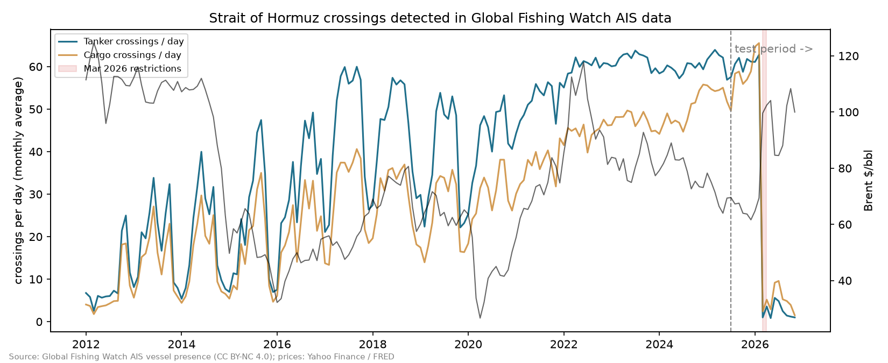

# Data feasibility check

Run on 2026-11-05/06, **before any analysis of ships vs. oil prices**. Nothing below looks at whether ships predict oil. It only checks whether the data is good enough to ask the question.

Reproduce: `python scripts/pull_gfw.py 2012-01 2026-11`, `python scripts/pull_prices.py`, `python feasibility/summarize.py`.

## 1. Global Fishing Watch (historical ships): works ✅ (with one big caveat)

**Date range:** 1 Jan 2012 → 2 Nov 2026. GFW publishes with a lag of about 3–6 days.

**What we pulled:** hourly AIS presence for two boxes either side of 56.5°E in the strait, about 2.9 million vessel-hours.

**Crossings found:** 391,835 in total (all vessel types), after the 6-hour dedup.

**Tankers can be separated.** GFW's `vesselType` field has no "tanker", but its `geartype` field does (`TANKER`). Spot checks match real tankers: VLCCs such as *New Dragon* and *Bunga Kasturi Empat*, the LNG carrier *GasLog Skagen*, and a bitumen tanker. Cargo is separate: container ships, car carriers, bulk carriers.

**Tanker crossings per day (yearly average):**

| Year | Tankers/day | Cargo/day | Fishing/day |
|---|---|---|---|
| 2012–2016 | 9–33 | 7–22 | ~0 |
| 2017–2021 | 39–52 | 26–36 | ~0.1 |
| 2022–2025 | 59–62 | 45–55 | 0.4–0.7 |
| Jan–Feb 2026 | 61 | 64 | ~0 |
| Mar–Oct 2026 | ~1–6 | ~1–9 | ~0 |

**Gaps:** no day in 2012–2026 is missing GFW data completely.

**The caveat: coverage was unreliable before about 2021.**
- In 2012–2020 the counts swing in a yearly cycle: the quietest month is only 10–48% of the busiest.
- Tankers and cargo ships move in lockstep (monthly correlation 0.95–1.00).
- Real traffic doesn't halve every winter. This is the AIS *reception* changing, not the ships.
- A likely (unproven) reason: summer weather over the Gulf bends radio waves so shore receivers hear further. Satellite coverage got dense enough by about 2021 that this stopped mattering.
- From 2022 the quietest month is 89–94% of the busiest, and tankers and cargo move separately (correlation 0.36–0.60). That looks like real traffic.

**Checks on the crossing counts:**
- Only 0.2% of tanker crossings are the same ship crossing back within 24 hours, so there's no double counting.
- Our normal level (about 60 tankers/day in 2022–25) is about 20% above IMF PortWatch's published ~49/day. Most likely PortWatch leaves out small ships. Our most frequent crossers are small fuel-supply (bunker) tankers.
  - This changes the *level*, not the day-to-day *changes* we test.
  - Direct comparison is pending: PortWatch's download has been stuck on their side since 3 Nov.

**March 2026:** tanker crossings went 64 (Fri 27 Feb) → 45 (Sat 28 Feb) → 4 (Sun 1 Mar) → 0–2 a day for most of March.
- The drop happened **over the weekend, before oil markets reopened on Monday 2 March**. As flagged in HYPOTHESES.md, this is not evidence that ships "predict" oil: both reacted to the same Saturday news.
- During the crisis many ships reportedly switched AIS off. So AIS counts may *overstate* the collapse.

## 2. aisstream.io (live ships): key works, but no coverage here ❌

- 60 seconds of the whole world: 2,097 positions from 2,068 ships, so the key works.
- 3 minutes of the Gulf + Strait of Hormuz: **0 positions**.
- This matches the yasumorishima reference repo, which found the same in Sept 2026. The free volunteer receivers don't cover this water.
- **Closest free alternative:** the dashboard shows the latest GFW day (about 3–6 days behind), clearly labelled. It also keeps an aisstream panel that says honestly when nothing is coming through.

## 3. Prices: work ✅

- **Yahoo Finance:** Brent `BZ=F` and VIX `^VIX` downloaded (2012 → today).
  - WTI `CL=F` and S&P 500 `^GSPC` could not be downloaded. Something on this network is intercepting Yahoo's price server ("self-signed certificate in chain"). We did not bypass that security check.
- **FRED (Federal Reserve):** Brent spot, WTI spot, S&P 500 (from Nov 2016 only, FRED's 10-year limit) and VIX all downloaded.
- **Brent futures (Yahoo) vs Brent spot (FRED):** daily moves correlate 0.78. Same oil, but different contracts and closing times. Good for a robustness check.
- **Dates line up:** every Brent trading day from 2012 to Nov 2026 has ship data. Using the proposed start (below): about 880 trading days for training and about 340 for the test.

## 4. Other sources checked

- **GFW "AIS off" (gap) events:** 0 found in the strait in a normal month. GFW seems not to model gaps this close to shore, so it's not useful for dark ships here.
- **GFW Sentinel-1 radar detections** (2017 → about 5 days ago) are the best free route for dark ships. To be tested at the extension stage.
- **IMF PortWatch:** daily Hormuz transits by vessel type, 2019+, independent satellite AIS. Their server's data export is stuck. Retry later for validation.

## Proposed plan (needs your OK, then logged in HYPOTHESES.md "Deviations")

1. **Main analysis starts 2022-01-01.** Training 2022-01-01 → 2025-06-30, test 2025-07-01 → latest. Reason: data quality only (above), decided before any ship–oil analysis.
   - Robustness runs: from 2021-01-01 and from 2017-01-01, reported in full and clearly labelled.
   - Training still contains two disruption periods (Apr 2024, Jun 2025). The 2019 one is dropped.
2. **Tanker = GFW `geartype == TANKER`** (oil, chemical and gas tankers, the equivalent of AIS types 80–89). `CARGO_OR_TANKER` (about 1–2% of crossings) only in a robustness check.
3. **Prices:** Brent and VIX from Yahoo as planned. S&P 500 and WTI from FRED (main). Yahoo versions only as a robustness check if they can be downloaded later.
4. **Fishing placebo:** fewer than 1 crossing a day, so it's reported but uninformative (as pre-registered). Cargo is the main placebo.
5. **Live feed:** GFW-latest plus an honest aisstream status panel, as above.

---
Data: **Powered by [Global Fishing Watch](https://globalfishingwatch.org)** (AIS Vessel Presence, CC BY-NC 4.0, accessed Nov 2026). Prices: Yahoo Finance; FRED, Federal Reserve Bank of St. Louis.
