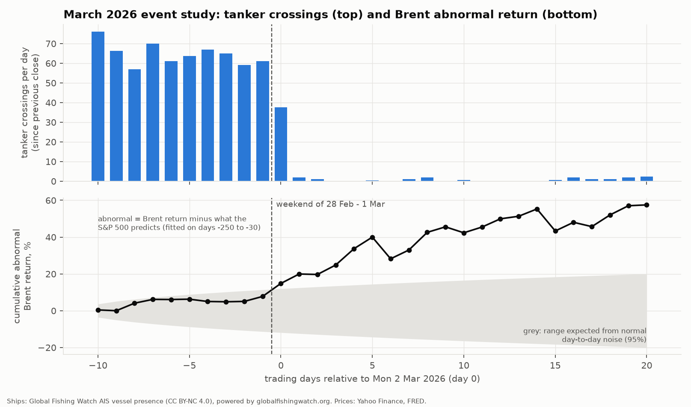
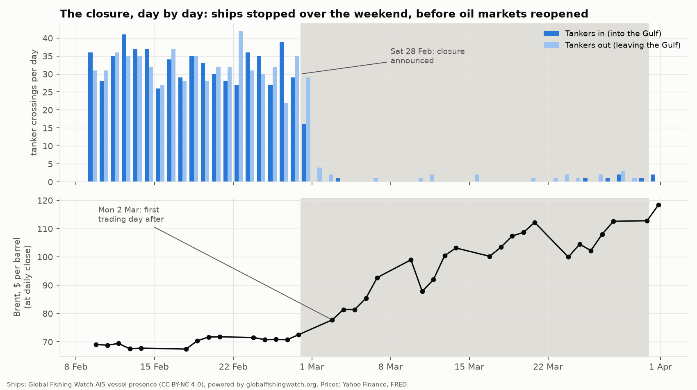
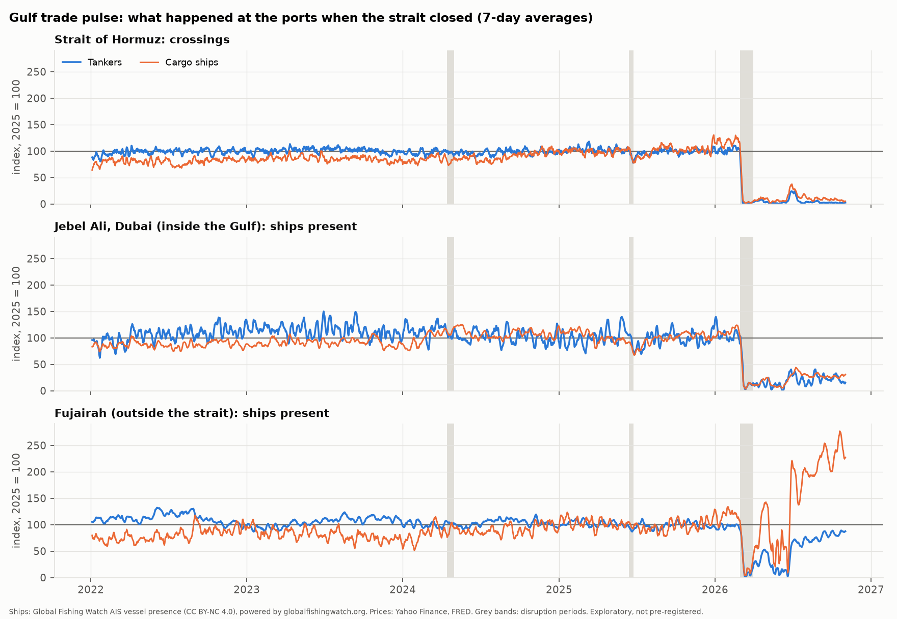
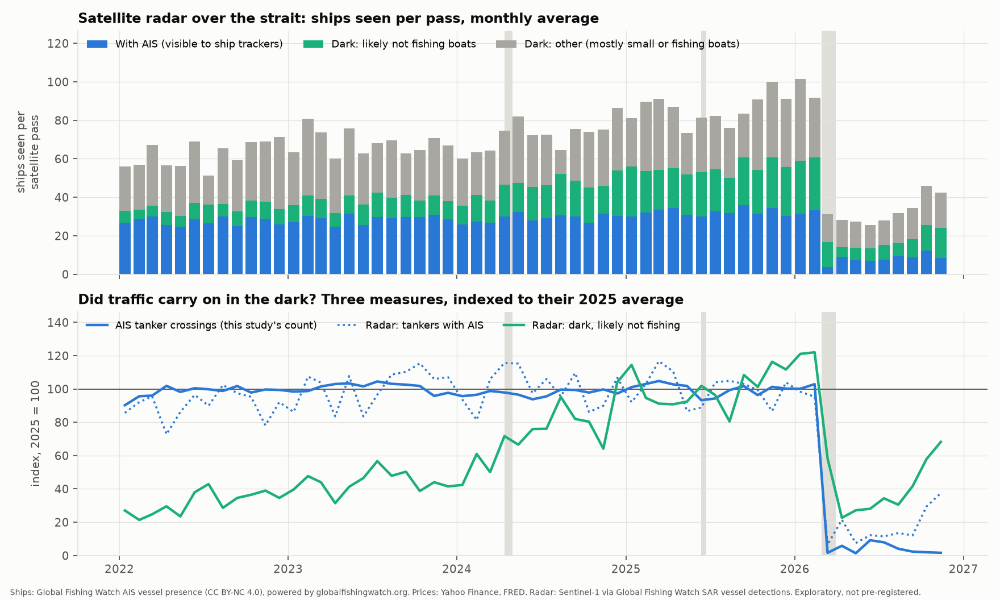

# Results: Can Ships Predict Oil Prices?

All tests follow [HYPOTHESES.md](HYPOTHESES.md), including the logged data decisions. Training = 2022-01-01 → 2025-06-30 (877 trading days). Test = 2025-07-01 → 2026-11-03 (340 days). Numbers come from `scripts/run_*.py`; raw outputs are in `results/`.

## The short answer

- **In normal times, no.** Daily changes in tanker crossings do not predict Brent. Brent doesn't predict crossings either.
- **In the March 2026 crisis, both moved together, and the oil market moved first.**
  - Brent rose about 8% more than the stock market explains in the two weeks *before* ships stopped. (Weak evidence on its own: t = 1.3.)
  - Ships stopped over the weekend of 28 Feb – 1 Mar. Brent jumped at the first chance it had, Monday's close.
  - After that, oil kept rising for weeks while ship traffic stayed near zero.
- **The pre-registered H1 is not supported.**

## Scorecard against the pre-registered criteria

| Test | What we expected | What we found | Verdict |
|---|---|---|---|
| **H1** (training): a drop in crossings → higher Brent over 1, 3, 7 days | Negative coefficient, significant after Holm | Wrong sign (positive) and tiny. A 10% drop in crossings → Brent **−0.09% to −0.12%**. Holm p = 0.75 | ❌ Not supported |
| **H1** held-out (test) | Out-of-sample R² > 0, Clark–West p < 0.05 | R² = **−13%, −13%, −8%** (worse than "assume the average"); Clark–West p = 0.97 / 0.96 / 0.85 | ❌ Not supported |
| **H2** (training): stronger in Apr 2024 / Jun 2025 disruptions | Negative interaction | Positive (wrong way); Holm p = 0.58 / 0.065 / 0.58; only 19 days | ❌ Not supported |
| **H2** (test): stronger in March 2026 | Negative interaction | 7-day horizon: **negative, Holm p = 0.011**. 1- and 3-day: nothing (p = 1.0) | ⚠️ Partly: one horizon, one event, 22 days |
| **H3** placebo: cargo and fishing don't predict oil | Not significant | Not significant (Holm p = 1.0 for all 6) | ✅ Passes (but easy, since tankers didn't predict oil either) |
| **Lead–lag** (training, 21 correlations) | – | All between −0.06 and +0.06; none survives the BH correction (smallest adjusted p = 0.73) | Null |
| **Granger** (training, 1 lag by AIC) | – | ships → oil p = 0.41; oil → ships p = 0.81 (Holm) | Null |

**Overall: H1 not supported.** The pre-registered rule needed all three of: a significant negative effect in training, a clean placebo, and a held-out improvement. We got none of the first and last.

## What happens in the test period (includes the crisis)

These are **not** the confirmatory tests. They show where the "signal" people see comes from.

- **Re-fitting the model on the test period alone,** the H1 pattern appears:
  - a 10% drop → Brent **+0.06%** (1 day, Holm p = 0.023) and **+0.16%** (3 days, Holm p = 0.003); 7 days is borderline (p = 0.07).
- **Remove March–November 2026 and it disappears** (Jul 2025 – Feb 2026: Holm p = 0.11–0.58; the 7-day sign even flips).
- **Granger in the test period goes both ways:** ships → oil p = 0.012, **oil → ships p = 0.043**. That's feedback, not one leading the other.
- **Lead–lag in the test period also goes both ways:** a drop in ships is followed by higher oil over 0–2 days, *and* a rise in oil is followed by fewer ships over 1–10 days (correlations about −0.15 to −0.26).

So the apparent "ships predict oil" comes from **one extreme event**, in which both sides were reacting to the same news.

## The March 2026 event study

Day 0 = Monday 2 March 2026, the first trading day after Iran's closure announcement on Saturday 28 February. "Abnormal return" = Brent's return minus what the S&P 500 predicts.

| Window | Brent abnormal return | Tanker crossings |
|---|---|---|
| Days −10 to −1 (13–27 Feb) | **+7.7%** (t = 1.3, not significant on its own) | Normal, 57–76 a day |
| Weekend 28 Feb – 1 Mar | market closed | Fell to 45, then 4 |
| Day 0 (Mon 2 Mar) | **+7.1%** | Average of Fri–Sun: 38 |
| Days 0 to +20 | **+57% cumulative** (t ≈ 5.6) | 0–2 a day |

- **Before the closure: oil moved first** (weak evidence). Prices rose on escalation news while ships kept sailing normally.
- **At the closure: no real lead either way.** Ships stopped on Saturday because that's when the news broke; Monday was oil's first chance to react. (We flagged this weekend effect before seeing any data.)
- **After the closure: oil kept adjusting** for three weeks, with big swings (−12% on 10 March, −12% on 23 March), while ship counts sat at zero. The counts had nothing new to say.

## Robustness (all for H1 in training; none changes the answer)

None is significant after the Holm correction:
- start dates 2021 and 2017
- Brent spot (FRED) instead of futures
- WTI instead of Brent
- day-on-day and 7-day shock measures
- inbound only; outbound only
- adding the "cargo-or-tanker" ships

The smallest corrected p is 0.16. The 2017-start model also fails the held-out test (R² −3% to −5%). Full table: `results/robustness_h1.csv`.

## Why the answer is probably "no" in normal times

- About 60 tankers a day pass through. A day with 10% fewer is mostly scheduling noise (and AIS reception noise), not a supply shock.
- The oil market learns about real supply changes from many faster sources: news, OPEC, satellite firms that track tankers, and traders' own information. By the time a change shows up in free AIS data, it's already in the price.
- Free AIS data reaches us about 3–6 days late. Even a real signal couldn't be traded on.

## Extensions (exploratory: not pre-registered)

These were in the project brief as extras. They were added after the main results, so treat them as descriptive, not as tests of a prediction.

### 1. Gulf trade pulse: Dubai (Jebel Ali) vs Fujairah

- **What:** ships present each day in a 12-nautical-mile circle around Jebel Ali (inside the Gulf) and a 10-nm circle around Fujairah (outside the strait, end of the pipeline that lets UAE oil skip Hormuz). Same GFW data, daily, one count per ship per day.
- **Normal times (2025):** Jebel Ali had about 74 cargo ships and 14 tankers a day; Fujairah about 109 tankers and 30 cargo ships.
- **March 2026:** everything fell, even Fujairah, which is outside the strait: Jebel Ali to 14–18% of normal, Fujairah to 17–23%.
- **After March: Fujairah recovered and Jebel Ali didn't.**

  | Ships present, % of 2025 average | Mar 2026 | Apr 2026 → latest | Oct 2026 |
  |---|---|---|---|
  | Strait tanker crossings | 2% | 5% | 2% |
  | Jebel Ali cargo ships | 14% | 24% | 28% |
  | Jebel Ali tankers | 18% | 19% | 22% |
  | Fujairah tankers | 17% | 56% | 84% |
  | Fujairah cargo ships | 23% | 159% | 244% |

- **Reading:** trade moved to the port that doesn't need the strait. Cargo ships at Fujairah more than doubled (their goods can go on to Dubai by road), and tankers came back as the bypass pipeline kept working.
- **Does port traffic predict Brent?** No. Using the H1 model in the training period, none of the four port measures (tankers and cargo at each port) predicts Brent at 1, 3 or 7 days (12 tests, all Holm p = 1.0).

Script: `scripts/run_pulse.py`. Outputs: `results/gulf_pulse_periods.csv`, `results/gulf_pulse_regressions.csv`.

### 2. Dark ships: did tankers keep crossing with AIS switched off?

- **What:** Global Fishing Watch's Sentinel-1 satellite radar detections over the strait (the same area as the two crossing boxes). Radar sees a ship whether or not it broadcasts AIS. Each detection is matched to AIS or labelled "dark". The radar passes over every few days (454 passes since 2022), so the numbers are **ships seen per pass**.
- **Normal times (2025):** per pass, 32 ships with AIS (13 of them tankers) and 53 dark ones. Most dark detections are small boats (dhows, fishing, local craft); 23 per pass are labelled "likely not fishing".
- **After the closure:**

  | Per satellite pass, % of 2025 | Mar 2026 | Apr–Jun 2026 | Jul 2026 → latest |
  |---|---|---|---|
  | AIS tanker crossings (this study) | 2% | 5% | 4% |
  | Radar: tankers with AIS | 7% | 14% | 17% |
  | Radar: dark, likely not fishing | 58% | 26% | 41% |
  | Dark share of all radar detections | 88% | 71% | 73% (2025: 62%) |

- **Reading:**
  - **The collapse was real, not just ships hiding.** If tankers had kept sailing with AIS off, dark detections would have *risen*. They fell.
  - **But some traffic probably carried on in the dark.** Dark vessels fell much less than AIS ships, so the dark share rose from 62% to 73–88%. Radar can't tell us whether those are tankers or whether they crossed.
  - **The AIS tankers still in the strait are mostly parked.** In Oct 2026 only 54 tankers used AIS in the area (1,082 in Oct 2025), 92% of their positions were under 2 knots, and the most common flags were Iran, Nicaragua and Panama. That's why "radar tankers with AIS" (a snapshot, which counts parked ships every time) is higher than crossings (a flow).
- **Caveats:** the "likely not fishing" label rises steadily over 2022–2025 (probably changes in the detection model or satellite coverage), so only compare against 2025. Radar misses boats under about 15 m and can't see very close to shore.

Script: `scripts/run_dark.py`. Outputs: `results/dark_ships_periods.csv`, `data/processed/sar_passes.csv`.

## Limits (stated honestly)

- **One crisis = one data point.** The test-period results rest on a single event, so they can't show a repeatable pattern.
- **AIS coverage changes over time.** Before 2022 the counts had big yearly coverage swings (which is why the main sample starts in 2022). During the crisis, some ships kept moving without AIS: satellite radar shows dark traffic fell much less than AIS traffic (Extension 2). So the AIS collapse is real but somewhat exaggerated.
- **Oil reacts to much more than Hormuz:** OPEC decisions, the US economy and interest rates, China's demand, other conflicts (e.g. the big moves in Oct–Nov 2026).
- **Correlation is not causation.** Even the crisis results only show that ships and oil reacted to the same events, not that one caused the other.
- **Our tanker count includes small tankers** (bunker and coastal), so its level is about 20% above IMF PortWatch's. The comparison with PortWatch is still pending; their export was broken.
- **Price sources:** WTI and the S&P 500 come from FRED because this network blocks Yahoo's server for them. Brent futures and spot behave the same in every test.
