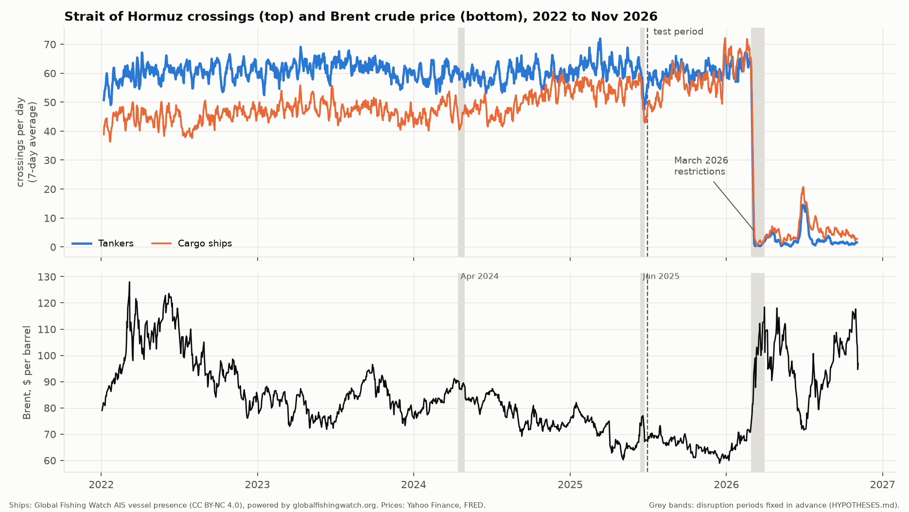
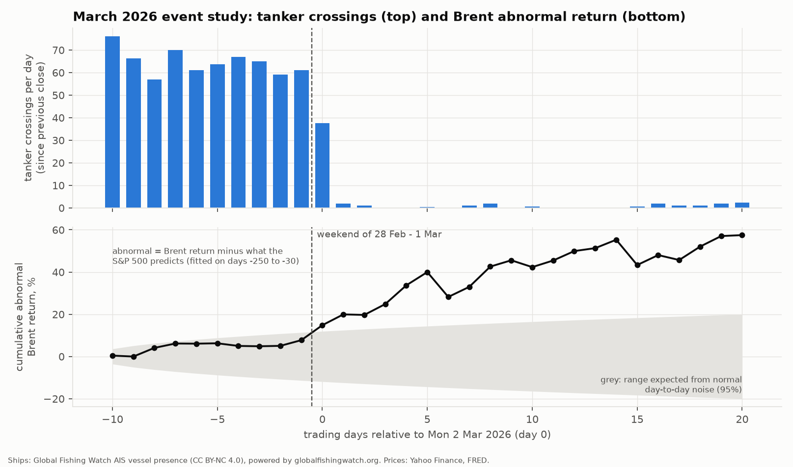
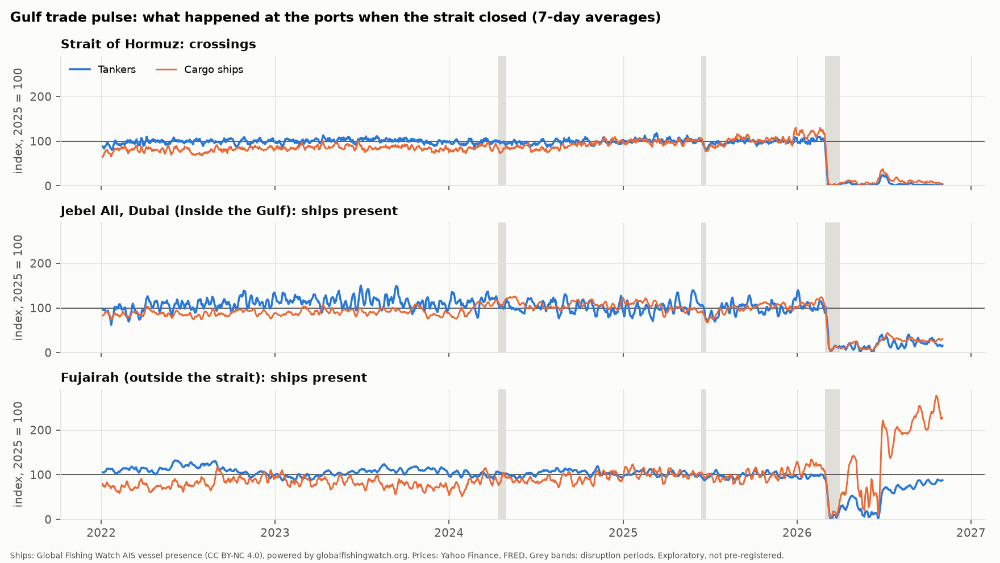
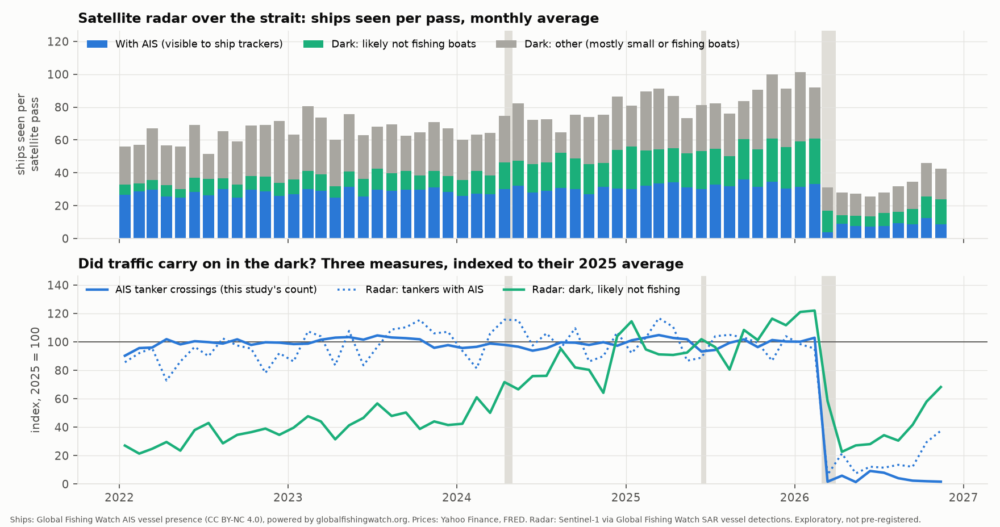

# Can Ships Predict Oil Prices?

Tanker traffic through the Strait of Hormuz and the price of Brent crude, January 2022 to November 2026

Yousuf · Independent research project (Year 13), Dubai · November 2026

**Summary.** About a fifth of the world's oil passes through the Strait of Hormuz. Using free ship-tracking data, I counted every tanker crossing the strait each day for nearly five years (92,708 crossings). I then tested whether a drop in crossings is followed by a rise in the price of Brent crude. I wrote down my predictions and tests before seeing any results.

- **In normal times, ships did not predict oil.** The effect was tiny and had the wrong sign. On data it had not seen, the model did worse than simply assuming the average.
- **In the March 2026 crisis, ships and oil reacted to the same news, and oil moved first.** Ship counts only seem to "predict" oil when this one crisis is included, and even then the link runs both ways.
- **Two extensions:**
    - After the closure, trade shifted to Fujairah, outside the strait.
    - Satellite radar confirms the collapse in traffic was real, though some ships kept moving without broadcasting their position.

## 1. The question

Ships broadcast their position, speed and type every few seconds using **AIS** (Automatic Identification System), a radio system designed to prevent collisions. Anyone can collect these signals, so in principle anyone can count the tankers leaving the Gulf each day.

That raises a simple question. If fewer tankers cross the Strait of Hormuz, less oil reaches the world, so the oil price should rise.

- **Could a free tanker count warn of a price rise before the market reacts?**
- **Or is the market faster, so prices move first and ships follow?**

The answer matters beyond curiosity. Traders pay for ship-tracking data on the assumption that it holds information prices don't yet reflect. If even a clear, physical signal like Hormuz traffic doesn't lead prices, that tells us how quickly markets absorb information.

## 2. What I predicted, before seeing the results

On 5 November 2026, before downloading any data, I wrote my hypotheses and the exact tests into a file (HYPOTHESES.md) and saved it with a timestamp using git. This "pre-registration" stops me from changing the question to fit whatever the data shows.

- **H1:** a drop in tanker crossings predicts *higher* Brent returns over the next 1, 3 and 7 trading days.
- **H2:** the effect is stronger during disruptions, especially the March 2026 restrictions.
- **H3 (placebo):** cargo ships and fishing boats crossing the strait should *not* predict oil. If they did, a tanker "effect" would more likely be a quirk of the data than a real supply signal.
- **Held-out test:** every model is fitted on data up to 30 June 2025 and then tested, unchanged, from 1 July 2025 onwards. Nothing is tuned on the test period.
- **When H1 counts as supported:** only if all three hold:
    - the training effect is negative and significant after correction;
    - the placebo is clean;
    - the model beats a simple average in the test period.

A few decisions had to be made after seeing the raw data but before any results, such as where the sample starts. Each is logged with its reason in the same file.

## 3. Data

| Data | Source | Notes |
|---|---|---|
| Ship positions, 2012 to 2 Nov 2026 | Global Fishing Watch (GFW), AIS vessel presence | One position per ship per hour; about 3–6 days' delay; licence CC BY-NC 4.0 |
| Satellite radar detections | GFW, Sentinel-1 radar vessel detections | Extension 2 only |
| Brent futures; VIX (a measure of market fear) | Yahoo Finance | Brent is the main outcome |
| S&P 500; WTI oil; Brent spot (as a check) | FRED, Federal Reserve Bank of St. Louis | Yahoo was blocked on my network for these |
| Live ship positions | aisstream.io | No positions received from the strait, so not usable |

**Counting a crossing.**

- I drew two boxes either side of 56.5°E, at the narrowest part of the strait, with a small gap between them.
- A ship seen in the western box and then in the eastern box within 24 hours counts as one **outbound** crossing (leaving the Gulf). The reverse is **inbound**.
- Each ship can count at most once every 6 hours.
- "Tanker" means GFW's tanker class.

**What the count looks like.**

- From January 2022 to 2 November 2026 there were **92,708 tanker crossings: about 60 a day before March 2026**, split evenly between in and out.
- That is about 20% above the IMF PortWatch count (about 49 a day), probably because I include small fuel-supply tankers.

**Why the main sample starts in 2022.** Before 2022, the counts rise and fall with the seasons in a way that comes from AIS reception, not shipping. Tanker and cargo counts moved almost perfectly together (correlation 0.95–1.00). From 2022 the counts are stable. Earlier start dates are used as a robustness check.

<figure class="w92"><figcaption><b>Figure 1.</b> Daily tanker and cargo crossings (7-day average, top) and the Brent price (bottom). Grey bands are disruption periods; the dashed line marks the start of the test period. Crossings held steady at about 60 a day until March 2026, then collapsed.</figcaption></figure>

## 4. Method, in plain English

- **No peeking at the future.** Brent's daily price is set at about 19:30 UTC. For each trading day I only use ships counted up to the end of the *previous* day.
- **Measuring a drop.** For each trading day, I compare the average crossings since the last trading day with the average of the 28 days before. A 10% drop gives a "shock" of about −0.1.
- **The main test (H1).**
    - A regression of Brent's return over the next 1, 3 and 7 trading days on the shock.
    - It controls for the stock market (S&P 500), market fear (VIX) and Brent's own latest move, so a ship effect can't just be general market mood.
    - Standard errors allow for overlapping returns (Newey–West).
- **Who moves first?**
    - Correlations between ships and oil at leads of 0–10 days, in both directions.
    - Granger tests, also in both directions. They ask: does knowing past ship counts help predict oil, beyond oil's own past? And the reverse?
- **Held-out test.** Out-of-sample R² compares the model's forecasts with "just assume the average return". Above zero means the model helps. The Clark–West test checks whether any gain is real.
- **Event study for March 2026.** "Abnormal return" is Brent's return minus what the S&P 500 would predict, using a model fitted on the year before the event.
- **Many tests means some false alarms.** At the usual 5% level, about 1 test in 20 looks significant by luck. I adjust p-values for this:
    - the Holm method for the main tests;
    - Benjamini–Hochberg for the lead–lag scan.

## 5. Results

### 5.1 Normal times (training period, January 2022 to June 2025): no

| Test | Result | Verdict |
|---|---|---|
| H1: drop in crossings → higher Brent | A 10% drop was followed by Brent *falling* 0.09–0.12% (wrong sign); Holm p = 0.75 | Not supported |
| H1 held-out (July 2025 to November 2026) | Out-of-sample R² of −13%, −13% and −8% (worse than the average); Clark–West p = 0.97, 0.96, 0.85 | Not supported |
| H2: stronger in the 2024 and 2025 disruptions | Wrong sign; Holm p = 0.58, 0.065, 0.58 (only 19 days) | Not supported |
| H3 placebo: cargo and fishing | Nothing (Holm p = 1.0 for all six tests) | Passes, but easily |
| Lead–lag (21 correlations) | All between −0.06 and +0.06; none significant | No lead either way |
| Granger | Ships → oil p = 0.41; oil → ships p = 0.81 | No lead either way |

**Robustness.** Nine checks all give the same answer; the smallest corrected p-value is 0.16. The checks were:

- earlier start dates (2017, 2021);
- Brent spot instead of futures, and WTI instead of Brent;
- other ways of measuring the drop;
- inbound or outbound crossings only.

**Why the answer is probably "no".**

- On a normal day, 10% fewer tankers is about six ships. That is mostly scheduling and radio-reception noise, not a change in supply.
- Real supply news reaches the market through faster channels: news, OPEC statements and paid tanker-tracking services.
- Free AIS data arrives 3–6 days late anyway.

### 5.2 The March 2026 crisis: oil moved first

<figure class="w80"><figcaption><b>Figure 2.</b> Tanker crossings (top) and Brent's cumulative abnormal return (bottom), 10 trading days before to 20 after Monday 2 March 2026. The grey area is the range expected from normal day-to-day noise.</figcaption></figure>

- **Before (13–27 February):** Brent rose 7.7% more than the stock market explains, while tankers crossed normally at 57–76 a day. This is weak evidence on its own (t = 1.3).
- **The weekend (28 February to 1 March):** Iran announced restrictions on the Saturday. Crossings fell to 45, then 4. Markets were closed.
- **Day 0 (Monday 2 March):** Brent's abnormal return was +7.1%. This was its first chance to react.
- **The next 20 trading days:** Brent's cumulative abnormal return reached **+57%** (t ≈ 5.6), with swings both ways (−12% on 10 and on 23 March). Crossings stayed at 0–2 a day.

So oil moved before ships in the run-up. At the closure, both reacted to the same weekend news. After that, the ship count was stuck near zero and had nothing new to say about the price.

**H2 in the test period.** Only one of three horizons shows the predicted stronger effect:

- 7 days: the interaction is negative (Holm p = 0.011);
- 1 and 3 days: nothing (p = 1.0).

With one event and 22 days of data, this is weak support at best.

**Where the apparent "signal" comes from.**

- Re-fitting the H1 model on the test period alone does show the predicted pattern. A 10% drop is followed by Brent rising 0.06% the next day (Holm p = 0.023) and 0.16% over 3 days (p = 0.003).
- Remove March to November 2026, and it disappears (p = 0.11–0.58).
- In the test period, Granger tests run **both ways**: ships → oil p = 0.012, and oil → ships p = 0.043.

That is feedback around one shock, not ships leading oil.

## 6. Extensions (exploratory, not pre-registered)

### 6.1 The Gulf trade pulse: Dubai vs Fujairah

I also counted ships present each day at two ports: **Jebel Ali,** Dubai's main port, inside the Gulf, and **Fujairah,** outside the strait, at the end of a pipeline that lets UAE oil bypass Hormuz.

<figure class="w88"><figcaption><b>Figure 3.</b> Strait crossings and ships present at each port, as a percentage of the 2025 average (7-day averages).</figcaption></figure>

- **March 2026:** both ports emptied. Jebel Ali fell to 14–18% of its 2025 level, and even Fujairah fell to 17–23%.
- **Afterwards, Fujairah recovered and Jebel Ali did not.**
    - By October 2026, Fujairah had 84% of its normal tankers and 244% of its normal cargo ships.
    - Jebel Ali was still at 22–28%.
- **Trade shifted to the port that doesn't need the strait.**
- **Port traffic didn't predict Brent either:** 12 tests in the training period, all with Holm p = 1.0.

### 6.2 Dark ships: were tankers hiding?

Ships can switch AIS off. If tankers kept crossing "dark", my count would exaggerate the collapse.

- Satellite radar (Sentinel-1) sees ships whether or not they broadcast AIS.
- Global Fishing Watch labels each radar detection as either matched to an AIS signal or "dark".
- The radar passes every few days (454 passes since 2022), so I compare ships seen per pass.

<figure class="w88"><figcaption><b>Figure 4.</b> Top: ships seen by radar per satellite pass. Bottom: AIS tanker crossings, radar tankers with AIS, and dark vessels that are likely not fishing boats, each as a percentage of its 2025 average.</figcaption></figure>

- **Normal times (2025):** per pass, radar saw 32 ships with AIS (13 of them tankers) and 53 dark detections, mostly small local boats.
- **After the closure:**
    - radar tankers with AIS fell to 7–17% of normal;
    - dark vessels that are "likely not fishing" fell too, to 26–58%.
- **So the collapse was real.** If tankers had switched to sailing dark, dark detections would have gone up, not down.
- **But it was somewhat exaggerated.** Dark traffic fell less than AIS traffic, and radar can't tell whether those dark vessels were tankers.
- **The few tankers still broadcasting were mostly parked.** In October 2026, 92% of their positions in the strait were at under 2 knots. The most common flags were Iran, Nicaragua and Panama.

## 7. Limits

- **One crisis is one data point.** All the interesting test-period results rest on March 2026.
- **AIS coverage changes over time.** This is why the sample starts in 2022. During the crisis, some ships also moved without AIS (Section 6.2).
- **Oil reacts to much more than Hormuz:** OPEC, the US economy, China's demand and other conflicts. The stock-market and VIX controls only remove part of this.
- **Correlation is not causation.** Even the crisis results only show ships and oil reacting to the same events, not one causing the other.
- **My count includes small tankers,** so its level is about 20% above the IMF's. This shouldn't affect day-to-day changes. A full comparison wasn't possible because PortWatch's data export failed.
- **Data access.**
    - WTI and the S&P 500 came from FRED, not Yahoo, because my network blocked Yahoo for those.
    - Live AIS from aisstream.io had no coverage of the strait, so the dashboard shows GFW data with a few days' delay.

## 8. Conclusion

A free daily count of tankers through the world's most important oil chokepoint did not predict the oil price in normal times. The market didn't predict the count either.

In the one real crisis, the oil market moved first and kept moving long after the ship count had hit zero.

Ship data is excellent at showing *what happened*: the collapse in traffic, the shift of trade to Fujairah, the ships that went dark. But by the time a change shows up in free data, the price has already moved. **The pre-registered hypothesis H1 is not supported.**

## Credits and data licences

- **Powered by Global Fishing Watch.** AIS vessel presence and Sentinel-1 radar vessel detections © Global Fishing Watch, used under CC BY-NC 4.0 for non-commercial research.
- **Prices:** Yahoo Finance; FRED, Federal Reserve Bank of St. Louis. **Live AIS:** aisstream.io.
- **Ideas reused (no code copied):**
    - KaiErikNiermann/hormuz-crossing-tracker: dividing meridian and de-duplication (the repository was no longer public).
    - yasumorishima/hormuz-ship-tracker: transit logic, the 6-hour window, port zones, and the finding that aisstream doesn't cover the strait.
    - Blurjp/QuantTrade: radar ship detection.
- **Code, data and full results:** the project repository (README.md, HYPOTHESES.md, RESULTS.md), including a live dashboard. Code was written with help from an AI coding assistant (Claude, by Anthropic).

## References

Adland, R., Jia, H. & Strandenes, S. P. (2017). Are AIS-based trade volume estimates reliable? The case of crude oil exports. *Maritime Policy & Management*, 44(5), 657–665. 
Benjamini, Y. & Hochberg, Y. (1995). Controlling the false discovery rate. *Journal of the Royal Statistical Society B*, 57(1), 289–300. 
Campbell, J. Y. & Thompson, S. B. (2008). Predicting excess stock returns out of sample. *Review of Financial Studies*, 21(4), 1509–1531. 
Cerdeiro, D. A., Komaromi, A., Liu, Y. & Saeed, M. (2020). World seaborne trade in real time: a proof of concept for building AIS-based nowcasts from scratch. IMF Working Paper 20/57. 
Clark, T. E. & West, K. D. (2007). Approximately normal tests for equal predictive accuracy in nested models. *Journal of Econometrics*, 138(1), 291–311. 
Granger, C. W. J. (1969). Investigating causal relations by econometric models and cross-spectral methods. *Econometrica*, 37(3), 424–438. 
Holm, S. (1979). A simple sequentially rejective multiple test procedure. *Scandinavian Journal of Statistics*, 6(2), 65–70. 
Kroodsma, D. A. et al. (2018). Tracking the global footprint of fisheries. *Science*, 359(6378), 904–908. 
MacKinlay, A. C. (1997). Event studies in economics and finance. *Journal of Economic Literature*, 35(1), 13–39. 
Newey, W. K. & West, K. D. (1987). A simple, positive semi-definite, heteroskedasticity and autocorrelation consistent covariance matrix. *Econometrica*, 55(3), 703–708. 
Paolo, F. S. et al. (2024). Satellite mapping reveals extensive industrial activity at sea. *Nature*, 625, 85–91.

